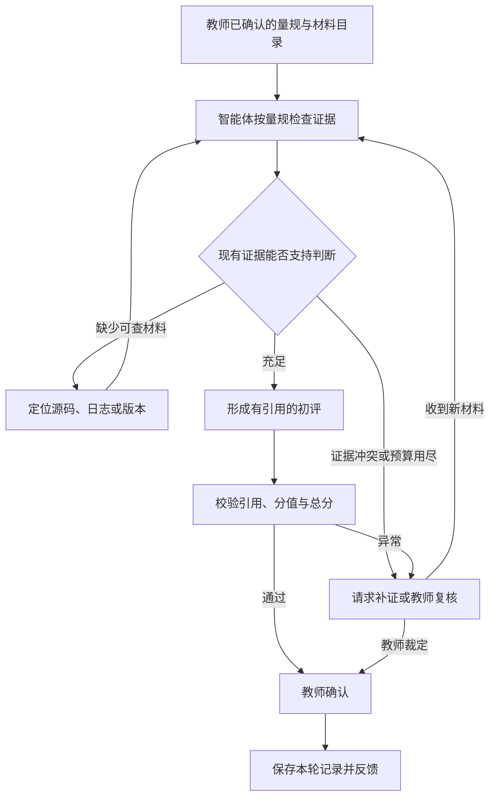

# GradeTap 智能体改造开发方案

**多教师正式使用版 · 2026 年 11 月 24 日 · 面向项目负责人、课程教师与开发团队**

建议在现有 GradeTap 中建设两个面向教师的智能体：**备课资源生成智能体**负责把课程标准、班级学情和企业案例转化为可审核的课堂材料；**编程作业批改智能体**负责按量规主动查证，形成有出处的初评，遇到材料矛盾时转教师复核。Python 和程序设计基础先用两者打通一节完整课堂；鸿蒙实训复用批改智能体，增加专用规则、三方评价和两轮提交对照。

首批演示选两件教师看得见的事：一份练习从哪里来、怎样修改后用于课堂；一处分数为什么给、哪条新证据使判断改变。首批开发并行完成两件事：建立教师账号和授课班授权，保护已有批改及修订记录。一个老师能看见哪些课、一项成绩是谁确认的、学生第二轮改了什么，都应能从系统记录中回答。

## 一、两份申报书分别要交付什么

| 项目 | 教学对象与范围 | 需要开发的产品能力 | 验收时应能拿出的材料 |
|---|---|---|---|
| “课堂革命·数智赋能” | 2026 级软件专业双高试点班《Python 编程基础与通用应用实践》、学徒制班《程序设计基础》，两班合计约 60 人 | 基于课标、知识点、学情生成导入案例、思政融入建议、分层练习、学习目标；教师审改入库；综合代码、运行结果、测试反馈、提交记录、日志形成批改结果、错因和建议；向校内智慧教学平台交付结果 | AI 辅助教学网络平台；约 5000 字课堂改革案例，包含背景、做法、成效、反思；30–45 分钟示范课堂视频，体现师生互动；一套配套数字化教学资源；两班试点记录和平台对接凭证 |
| “多维立体”AI 赋能实训评价改革 | 软件技术 2510 班，33 人；《鸿蒙移动通信应用开发》72 学时，其中实训 44 学时。围绕“5G 通信服务管理系统”，按界面开发、业务数据交互与功能实现、综合应用开发与调试三个子任务覆盖 9 个教学模块 | 采集 ArkTS/ArkUI 源码、构建日志、测试记录、版本历史、AI 使用说明，并关联工单、项目文档和答辩材料；100 分制四维量规、底线项、置信度、教师复核、企业评审、学生自评互评；二次提交、个人能力画像与班级看板 | 三个任务书、评价量规和三类评价表；系统源码及数据库结构；提示词、规则库、典型样例和调用记录；部署手册和测试报告；匿名数据、两轮改进与一致性分析；成果登记、典型案例、总结和教改论文 |

**范围取舍。** 两项目共用模型调用、课程与任务、证据定位、复核和审计；各自保留课程标准、试点班、量规、数据集和验收目录。鸿蒙模块限定在该课程的三个子任务。学生只需提交证据、查看反馈、二次提交和评价；企业导师只处理分配的阶段评审与综合验收。Python 项目当前交付到教师可审改的备课素材与教学资源包，整份教案和 PPT 的自动排版可留作后续扩展。

多教师账号、管理员后台和运行保障是本轮新增的投用要求，供两个项目共用。两份申报书各自的教学成果和经费仍按原口径验收。

**两个日程口径需要及早核对。** “课堂革命”年度实施表把平台对接、案例和视频列在 12 月，负责人承诺栏同时写有“2026 年 12 月前完成全部建设任务”。由负责人核实学校采用的日期；在口径明确前，优先以里程碑 A（预发布可演示版本）为最近目标，提前准备可演示版本和已有真实材料。下文按阶段划分执行顺序，外部教学与申报节点仅作参照，试点完成度、班级进度与既有成果以项目组记录为准。

## 二、现有代码能复用什么，先补哪几个缺口

基线为 `FerretDoll/GradeTap` 的 `main@96e4d35`（提交于 2026-09-14）。以下是代码检查，开工应记录实际部署的提交、数据库类型、启用的模型配置以及一份脱敏样例，核对线上差异。

| 位置 | 在该提交查到的行为 | 本次改造 |
|---|---|---|
| `backend/app/api/task_api.py`、`services/grading_service.py`、`services/teacher_review_service.py` | 已有答案和证据提取、按题评分、教师改分、修订和 Excel 导出。单条复核可令任务变为已复核；旧版 `export-results` 允许客户端传 `teacher_revisions` 并回落到 AI 分 | 复用评分和教师修订服务。复核操作者强制取自服务端会话；正式同步/导出前逐项核验确认状态并生成发布快照，按 `release_id` 导出正式版时完全忽略客户端传分；批改中的 Excel 可保留为明确标记的草稿 |
| `services/evidence_extractor_service.py`、`student_prepare_service.py`、`grading_service.py`、`task_service.py` | 重新准备或提取、部分重批清理路径会删除先前结果和教师修订；`task_service.py` 的 `delete_task` 会级联物理删除 `TeacherRevision`、`AuditLog`、`UploadedFile` 及磁盘原件 | 新建提交轮次和评价版本，原始件、已确认结果和修订只追加；已有教师修订或已发布成绩的任务禁止物理删除（返回 `409`），改走归档接口（`POST /api/tasks/{id}/archive`），且任何删除操作均禁止物理删除 `AuditLog`。用自动化 `pytest` 锁定“复核后重跑”“二次提交查看首轮”与“删任务拦截/归档保护”三项回归 |
| `task_api.py` 查重接口（`plagiarism_*`）与 `models.py` 查重三表 | 已实现 `plagiarism_check`、`student_plagiarism_summary`、`plagiarism_match` 及 4 个查重端点，目前无租户/授课班鉴权且未区分提交轮次 | 统一纳入授课班权限校验、历史数据迁移清单和自动化越权测试；按需关联提交轮次 |
| `api/settings_api.py` 与 `services/settings_service.py` | `/api/settings/llm` 当前无身份与角色限制，前端任意访问者均可读写或清空共用 API Key | 在账号体系首批上线时即将 `/api/settings/llm` 收归管理员权限，普通教师端隐藏配置入口；后端以受控密钥引用替代明文展示 |
| `utils/zip_submission_parser.py`、`services/file_parse_service.py` | 学生 ZIP 解析以 DOCX、PDF、TXT、MD 为主。源码、日志和测试报告需要各自的类型与定位 | 扩展 `.py`、`.ets`、`.log` 和结构化测试/版本清单；支持每人多文件。保留相对路径、行号或用例 ID、轮次、来源与哈希。源码按文本读取 |
| `services/llm_service.py` | 已集中封装文本、JSON 和流式调用，并可修复部分 JSON 格式错误 | 增加多消息与工具调用适配、参数和结果的结构校验、模型能力探测、调用预算和用量。沿用现有模型设置 |
| `tasks/grading_pipeline.py`、`tasks/celery_tasks.py`、`services/progress_event_service.py` | 流水线文件列出阶段，Celery 文件注册 ping；批量评分有后台线程，进度事件存在进程内 | 先用数据库运行表与步骤表实现可暂停/恢复的最小闭环；后续阶段再接入 Celery/Redis 异步投递、跨进程 SSE 续读与按需 LangGraph 检查点 |
| `task_api.py` 中的 `reflect-grading` 和 `route-review` | 两个端点只返回 queued；仓库已有反思与复核路由服务，可独立接入 | 异常检查先算总分与范围，再按需调用反思服务，实际持久化分流结果。接口返回可查询的 `run_id` |
| `db/models.py`、`db/init_db.py`、`core/config.py` 及业务服务内自动改表逻辑 | 已有 `CourseAssignment` / `CourseAssignmentQuestion` / `CourseAssignmentQuestionRubric` 表与全套课程作业接口，但 `GradingTask` 仅靠字符串弱关联课程与班级；默认 SQLite、无 Alembic，且 `models.py` 直接导入 `sqlalchemy.dialects.mysql.JSON`；业务请求中仍存在多处运行期 `ALTER TABLE` / `create_all`（`init_db.py`、`course_service.py`、`task_service.py`、`grading_service.py`、`plagiarism_check_service.py`） | 统一改为通用 `sqlalchemy.JSON` 并引入 Alembic 迁移，**同步彻底退出业务代码与启动期的全部自动建表/改表逻辑**，由 Alembic 唯一管理数据库结构；补齐 `GradingTask` 对 `offering_id`/`course_id`/`assignment_id`/`class_group_id` 的外键；备课批准转作业直接幂等写入现有 `CourseAssignment` 体系；在双教师正式试点前完成生产 MySQL 迁移与备份恢复演练 |
| `frontend/src/App.vue`、`stores/taskStore.js`、`api/client.js`、`vite.config.js`、`.env.example` | `App.vue` 为 9,682 行巨石单文件且无 `vue-router`；`taskStore.js` 的 `mergeTasks` 与 `App.vue` 内 10+ 个 `localStorage` 键做离线合并；`client.js` 与 `frontend/.env.example` 均指向跨源绝对地址 `http://127.0.0.1:8000/api` 且未开启 `withCredentials` | 引入 `vue-router`，新增登录/管理/授课班页面放在独立视图目录（禁止继续堆入 `App.vue`）；配置 Vite `/api` 同域代理与 `withCredentials: true`，**同步将 `frontend/.env.example` 改为 `VITE_API_BASE_URL=/api` 并检查本地 `.env`/`.env.local` 不绕过代理**；彻底废除跨账号 `localStorage` 合并逻辑，切号/退出清空全部本地缓存 |

[代码基线](https://github.com/FerretDoll/GradeTap/tree/96e4d351e0db65d186a85524f0e2dfe5944b60ba) · [批改路由](https://github.com/FerretDoll/GradeTap/blob/96e4d351e0db65d186a85524f0e2dfe5944b60ba/backend/app/api/task_api.py) · [证据重提取](https://github.com/FerretDoll/GradeTap/blob/96e4d351e0db65d186a85524f0e2dfe5944b60ba/backend/app/services/evidence_extractor_service.py) · [成绩导出](https://github.com/FerretDoll/GradeTap/blob/96e4d351e0db65d186a85524f0e2dfe5944b60ba/backend/app/utils/excel_export.py)

## 三、多教师账号、授课权限与管理后台

首版按**同一学校、多位教师、可联合授课**设计。每位教师使用自己的账号，进入“我的教学工作台”。教师可以独立开课，也可以把指定授课班共享给另一位教师。学校统一身份认证可在后续接入；账号使用稳定的内部用户 ID，换邮箱或增加校内登录方式后，课程和修订历史仍归属于同一人。

### 1. 账号开通到离岗的流程

- **注册和启用。** 提供教师注册页，填写姓名、邮箱，设置密码并验证邮箱。试点推荐管理员向指定邮箱发一次性限时邀请，受邀教师完成注册后直接启用；自行申请的教师进入待审核名单。审核前只可看申请状态。管理员驳回时可填写原因，申请人可补充后重新提交。注册表单没有管理员角色选项。
- **登录和恢复。** 提供登录、退出、修改密码、忘记密码和重置入口。重置链接限时、单次使用，重置后撤销旧会话。首次管理员由部署负责人通过一次性初始化流程建立，不配置公共默认密码；管理员启用第二因素并登记恢复方式。
- **会话和凭证。** 同域部署 Vue 与 FastAPI。密码采用 Argon2id 哈希；服务端维护可撤销会话，经 HTTPS 下发 Secure、HttpOnly、SameSite Cookie。写操作校验 CSRF，登录或权限升级后轮换会话，登录、邀请、验证和密码恢复设频率限制。凭证和重置令牌不进入日志。上线前验证学校邮箱或项目发信服务能实际收信。
- **调岗和停用。** 管理员可停用账号、撤销在线会话、收回授课权限并移交课程。本人已做的师评、成绩发布与审计记录始终保留原作者。收回权限时同时处理在途任务，停止向原账号推送事件、下载文件和交付结果。保护最后一个可用管理员，防止误操作导致无人维护。

### 2. 角色和数据范围

| 身份 | 默认能看到什么 | 可以做什么 |
|---|---|---|
| 授课负责人 | 本人创建或受交接的课程、授课班、作业、批改和资源 | 邀请协作者、创建作业、确认量规、复核、发布正式成绩、导出和对接学校平台 |
| 协作教师 | 被明确分配的课程资源和授课班；同一课程的其他班级各自授权 | 默认备课、批改和填写复核建议；“发布成绩”“导出带身份明细”作为单独权限由负责人授予。学期结束可设置失效日期 |
| 系统管理员 | 账号、授权、课程归属、运行状态、用量及审计摘要 | 审核教师、移交授课班、维护模型和配额、处理异常任务。查看学生原文和修改成绩需要独立的教学授权；兼任教师时在授课范围内操作 |
| 学生、企业导师 | 学生本人的提交与已发布反馈、分配的匿名互评材料；企业导师被分配的阶段评审材料 | 按作业或评审邀请绑定身份；学生提交及互评、导师填写评审表。两类身份都不能通过教师注册入口自行升级权限 |

**数据怎样归属。** 在现有课程与班级之间增加“授课班”，用不可变 ID 关联课程、班级与学期，记录负责人和协作成员；同一行政班可以上不同教师的课，同名课程或班级可以并存。单独管理课程模板的归属与分享权限，分享题目或量规不会附带学生作业。任务保存授课班 ID，材料、成绩、证据、SSE 事件、导出文件和 Agent 运行沿同一关联检查权限。教师可建自己的班级名单；共用行政班名单由授权人员维护，协作教师只读取本授课班所需字段。

**代码落点。** 当前公开提交中，课程和任务列表查询未见按教师过滤，学生准备服务按班级名匹配；复核接口还从请求体读取 teacher_id。新增用户、邀请、会话、授课班及成员关系，更新 GradingTask 的关联字段；名称作为显示快照保留。FastAPI 从会话得到当前操作者，在服务端同时检查角色、具体对象及操作。客户端提供的教师 ID 不能用作身份依据。课程、班级、旧批改接口、设置、导出与文件下载统一接入；文件经授权才交付。按授课范围隔离检索索引、批改缓存和实时事件。入队时记录发起人、作用域、输入版本，worker 在执行及写回前重核授权。多教师共用的 API 密钥只由后台管理，以受控密钥引用替换配置中的原始值，管理页面只展示掩码和连接状态。

[课程与任务模型](https://github.com/FerretDoll/GradeTap/blob/96e4d351e0db65d186a85524f0e2dfe5944b60ba/backend/app/db/models.py) · [学生名单匹配](https://github.com/FerretDoll/GradeTap/blob/96e4d351e0db65d186a85524f0e2dfe5944b60ba/backend/app/services/student_prepare_service.py) · [系统模型设置](https://github.com/FerretDoll/GradeTap/blob/96e4d351e0db65d186a85524f0e2dfe5944b60ba/backend/app/services/settings_service.py)

### 3. 三个工作区和管理员界面

教师登录后首页显示“我的课程、我的授课班、待复核、最近的智能体任务”。共享课程注明自己的角色。学生或导师登录后进入自己的提交或评审任务。管理员使用独立的“系统管理”入口。

| 管理页面 | 首版能完成的操作 | 操作留痕 |
|---|---|---|
| 教师与账号 | 邀请、查询待审核申请、批准或驳回、停用、触发密码恢复、撤销会话 | 记录操作者、目标账号、时间、原因与生效状态 |
| 授课班与权限 | 查询归属、新增或撤回协作、授予发布或导出权限、离岗移交、处理旧数据归属 | 显示授权前后变化；移交后旧批改仍保留原作者 |
| 模型、用量与任务 | 配置并测试模型、轮换密钥、按教师或课程设预算和并发上限；查看失败原因、重试或取消指定任务 | 展示脱敏状态、费用和运行编号；重试沿用幂等控制，管理员不能在此直接改分 |
| 审计与系统健康 | 查询审核、授权、成绩发布、导出、配置变更记录，查看模型故障、队列积压、备份与恢复演练结果 | 审计记录独立于教学内容；支持按时间、操作者和对象筛选，运维日志屏蔽个人原文及密钥 |

**建议的接口。** `/api/auth` 提供 `csrf`、`register`、`verify-email`、`resend-verification`、`login`、`logout`、`me`、`resubmit` 和密码恢复；`/api/admin` 提供教师申请、邀请、账号状态、授课归属、用量和审计；`/api/settings/llm` 收归管理员权限；`/api/offerings` 提供授课班查询与创建，`/api/offerings/{id}/members` 管理授课成员。普通教师通过现有课程、班级、任务和查重 API 操作已授权的对象。前端区分未登录、待验证、待审核、已驳回（含具体原因与重提）、已停用和无对象权限；后台强制执行同一规则。管理员访问生产配置及提升角色时再次确认身份。

### 4. 旧数据归属与上线顺序

1. **先做归属清单。** 在数据库副本中盘点课程、班级、任务、学生数、附件、已发布成绩和教师修订；由课程负责人核对。实名作者不可考的旧记录标注为历史记录，不回填为首个注册人。
2. **再迁移和对账。** 先增加可空关联，在验证过的映射中回填 course_id、class_group_id、offering_id；重名、歧义与孤立任务进入受限的待认领清单。负责人确认后才对该班开放。按任务核对学生、附件与修订数，抽核首轮/次轮原件、最终分及导出的成绩表，再对新任务启用必填约束。旧模型配置在副本中迁移并验证可用后再切换，审计不显示密钥内容。
3. **双教师小范围试点。** 建两个独立账号，各自建同名课程、班级和文件，再只共享其中一个授课班，跑通注册、备课、批改、复核、发布、导出及撤权。试点教师用真实教学流程验收；影响成绩的并发修改通过版号检测，后保存的教师收到明确冲突提示。
4. **正式开放。** 负责人按下文的上线验收表签收，随后分批邀请教师。若需回退，保留账号、访问控制、师评和审计，暂停新智能体或切至受限维护模式。生产数据始终受账号权限保护。

账号实现可查阅 [OWASP 身份验证](https://cheatsheetseries.owasp.org/cheatsheets/Authentication_Cheat_Sheet.html)、[授权](https://cheatsheetseries.owasp.org/cheatsheets/Authorization_Cheat_Sheet.html)、[会话管理](https://cheatsheetseries.owasp.org/cheatsheets/Session_Management_Cheat_Sheet.html)、[密码存储](https://cheatsheetseries.owasp.org/cheatsheets/Password_Storage_Cheat_Sheet.html)及[密码恢复](https://cheatsheetseries.owasp.org/cheatsheets/Forgot_Password_Cheat_Sheet.html)指南。

## 四、两个智能体怎样工作

### 1. 备课资源生成智能体

入口设在「课程 → 备课」。教师选择课程、班级、课次和可用课时，可附上企业案例和本节教学重点。知识库先采用课程过滤、标签和全文检索，每个材料片段保存版本、页码或段落；按检索命中情况再决定是否增加向量检索。课程标准和授权案例拥有独立来源，学情只读教师已确认的班级汇总。

| 智能体观察到的情况 | 可选择的业务工具与动作 | 教师得到的结果 |
|---|---|---|
| 目标过宽，导入案例与课标对应不足 | 查课标条目、查企业案例片段；找不到匹配案例时标记为教师自拟情境 | 可观察、可评价的学习目标；导入问题及出处 |
| 有同知识点的班级错因记录 | 读取已确认的匿名错因分布；按课时生成基础、提高、迁移练习，再校验目标和难度覆盖 | 每层题目、预期表现、参考解法和量规草案；教师可逐项调整 |
| 首次开课，还没有本班学情 | 使用教师填写的先修基础，标明分层依据；遇到课标、教时或语言选择冲突时询问教师 | 显示依据和待决项；教师补充后从原节点续办 |
| 思政融入或案例缺少可核对出处 | 检索已审核素材；将素材落到一个具体教学决策，如处理真实业务数据时如何保护隐私 | 教师看到讨论问题、教学活动与依据，可采用、修改或弃用 |

教师审核后形成带版本的资源卡，按课程、知识点和难度入库；点击“生成作业草稿”复用现有课程作业和量规结构，教师确认后用于本节课。记录备课起止时间、编辑项和采用情况，为案例提供材料。两门课程分别设置教学语言和学情，不从课程名称推定学徒制班的编程语言。

### 2. 编程作业批改与诊断智能体

入口放在现有「自动批改」和「学生批改详情」。系统先固定本次教师确认的量规版本并建立材料索引。智能体看到题目、量规、材料目录及已查明的证据，可以决定下一步查源码、读用例、比版本、追查调试日志、形成建议或请求复核。服务端校验工具范围、证据位置、得分上限和总分。全班同题使用同一量规，查证路径允许因学生材料而异。

**Python 示例。** 教师布置“按业务类别汇总工单数量”。一次提交包含源码、测试结果和修订说明。若输出与期望不符，智能体先读失败用例，再定位到按类别累加的代码；若仅空输入失败，分别判断主逻辑和边界条件两个量规项。若学生附上的“全部通过”截图与文本报告相冲突，继续核对报告对应的提交版本；仍无法对应时，保留冲突并要求教师核对。学生收到定位到源码和用例的修改建议。

**鸿蒙示例。** 在“通信业务数据交互与功能实现”中，学生提交套餐列表页面、网络失败日志、测试记录和 AI 使用说明。正常加载截图能证明一次正常路径；离线日志和对应处理分支才支撑异常处理判断。智能体依据证据决定是否读取组件源码或版本差异；首轮缺复测记录时，该量规项显示“待补证”。第二轮上传修订代码和离线测试后，在同一量规下并排显示原问题、改动位置、复测证据、教师两次判断。AI 使用评价依据学生披露、修改说明、验证结果和答辩；单凭代码风格不能推断学生是否使用 AI。

**能否验出 Agent 起了作用。** 用同一题做三组输入：证据齐全、日志与源码冲突、缺关键文件。第一组应从最少证据得到初评，第二组应自行追加一次不同来源的查证，第三组应准确列出缺项并暂停。页面展示工具名称、证据引用、动作结果和简短理由；教师可以从暂停点继续，开发人员可回放每次运行。验收看实际工具调用和数据状态。

## 五、工程实现与接口边界

**建议技术路线。** 保留 Vue 3、FastAPI 和 SQLAlchemy（统一使用通用 `sqlalchemy.JSON` 并引入 Alembic），现有模型配置迁入管理员后台。智能体循环采用**分阶段演进**：首轮最小闭环先用数据库运行表与步骤表表达“选择动作 → 调工具 → 观察 → 继续或暂停”，保证可调试、可暂停恢复且不阻塞早期演示；进入运行保障阶段后，再按需接入 Celery/Redis 异步调度与 LangGraph 检查点，两条业务图共用同一套工具注册与审计接口。模型只决定白名单内的下一项动作；成绩、材料、审批等业务事实始终以 GradeTap 的事务记录为准。

| 组件 | 最小开发内容 | 必须保持的约束 |
|---|---|---|
| 工具注册和模型适配 | `search_course_material`、`get_class_misconceptions`；`list_evidence`、`read_evidence_span`、`read_test_result`、`compare_submissions`；`request_review`、`save_draft`。每个工具声明输入、输出、可用角色和读写范围 | 工具从已授权运行上下文取得课程、授课班、学生和轮次；显式校验参数。模型无法直接写正式成绩、访问其他学生文件或执行上传的代码 |
| 推理循环 | 工具返回证据 ID、内容摘要和状态（找到、缺失、冲突、错误）；模型选下一步，Pydantic 校验。建议首版每个异常量规项最多 4 次查证，整次任务另限时限额 | 超限、重复无进展、无效工具或模型故障均可暂停；所有重试计入同一预算。对没有原生工具调用能力的模型可使用受约束的动作 JSON；真实执行和结果回传保持一致 |
| 版本与存储 | 新增提交轮次（关联原提交、父轮次、材料清单）；证据定位（相对路径、行/页/用例、文件哈希、来源与生成版本）；运行、步骤、教师审核版资源、三方评价和发布快照。复用现有课程作业（`CourseAssignment`）、题目、量规、查重、证据、批改结果、教师修订等表 | 运行固定量规、规则、提示词、模型配置和输入版本。幂等键至少含任务、轮次、题目、量规及证据摘要、策略版本；再次运行生成新评价版本。教师已发布版本只读 |
| 作业队列与权限 | 每次运行有 `run_id`、持久化步骤、失败原因、租约或并发锁、用量和取消状态；教师授权后恢复。跨进程发布 SSE，客户端以事件序号或运行快照续读 | 队列重复投递不重复写入；学生只见本人的作业和发布反馈，互评只见分配的匿名材料；企业导师只见获分配材料；教师身份由服务端登录上下文确定 |
| 审核与同步 | 服务端验证逐项确认、教师修订和待处理冲突；按学校平台字段映射输出成绩及错因报告。记录批次 ID、已确认版本、行数、回执、失败原因和补传 | 有授权 API 时按唯一业务键增量同步，失败行单独重试。平台仅支持文件时先交付匹配模板并实测导入对账，记录人工导入与自动同步各自的验收状态 |
| 隐私与部署 | 教师端/教学环境产生构建与测试结果，网页只解析和引用；向模型发送最少必要材料，屏蔽姓名、学号、样例业务隐私和凭据。模型用量按项目、课程、运行记录 | 以配置控制原文访问和留存。预发布演示期可使用 SQLite，**双教师正式试点开放前（第一阶段收口）即完成生产 MySQL 迁移、权限与备份恢复演练**；鸿蒙项目 2026 年先用校内资源和免费额度开展实训试用，2027 年针对鸿蒙三方评价与 9 模块全量数据完成 MySQL 复测、部署测试与验收归档报告 |

**建议新增的 API 合同（开发命名）。** `POST /api/offerings/{id}/lesson-drafts` 按授课班创建备课运行（隔离班级学情与权限），`PATCH /api/lesson-drafts/{id}` 保存审改，`POST /api/lesson-drafts/{id}/approve` 批准并幂等写入现有 `CourseAssignment`；`POST /api/tasks/{id}/agent-runs` 以提交轮次、题号和量规版本启动诊断；`GET /api/agent-runs/{id}` 返回状态、步骤、待办和证据链接；`POST /api/agent-runs/{id}/resume` 携带人工决定、期望版本和幂等键恢复；`POST /api/tasks/{id}/releases` 为已确认成绩建立发布快照。创建运行返回 202，旧版本审核返回 409 供前端重载。已有教师改分接口改为强制读取会话身份；已有 `POST /api/tasks/{id}/export-results` 按 `release_id` 导出正式版时必须忽略客户端传入的 `teacher_revisions`，完全读取服务端发布快照。

**最小诊断记录示例**（仅演示结构）。`量规项=网络异常处理；轮次=R1；证据=E7·OfflineTest#03、E9·PlanList.ets第42–50行；发现=离线用例失败且失败分支未更新页面状态；建议=补错误提示并复测；处置=提交教师复核`。证据条目能点回归档原件；若发现引用不存在，服务器拒收该条判断。总分由程序按教师确认的量规计算。

**历史迁移。** 升级前先对试点副本做迁移演练。将旧提交和已存在的师评标为首轮，在无法重建文件定位时标记“历史材料无定位”；按任务核对迁移前后学生数、评分记录数、教师修订数、总分和导出样本。按课程开关灰度，新运行与旧评分入口共享权限、隔离写入；回退时关闭新入口，保留已形成的评价版本。

## 六、鸿蒙实训的教学设计要单独实现

| 递进子任务 | 建议先接入的一组证据 | 学生、教师和企业导师可以核对的内容 |
|---|---|---|
| 鸿蒙通信服务应用界面开发 | ArkUI 组件、界面运行记录、任务工单、迭代前后源码 | 界面是否完成业务要求，组件职责是否清楚，修改能否解释；截图只支持可见行为 |
| 通信业务数据交互与功能实现 | ArkTS、构建日志、路由传值、存储或网络用例、异常处理说明 | 用例是否对应本轮源码；区分正常路径通过、异常路径失败和缺少测试证据；企业导师可评价业务交付质量 |
| 移动通信综合应用开发与调试 | 集成测试、缺陷单、修复提交、发布检查、项目文档、AI 使用记录和答辩材料 | 聚焦五类通信服务功能的集成质量、交付和技术表达；以首轮缺陷及次轮复测逐项核验改进 |

系统提供 100 分制四维量规编辑与版本冻结，支持底线项、证据要求及教师裁定。教师过程评价、企业导师阶段/终期评价、学生自评互评分开记录，展示分歧及其依据。**录入课程团队核定的四维名称、分值、三方合成方式和底线处置后，再启用自动汇总。** 本方案可核材料未完整呈现申报书“项目改革内容”段的评分细目，因此没有代定正式权重。原型可以先用核定的一个量规项演示，再覆盖全部 9 个模块。

个人画像按量规维度与轮次呈现已证实能力、缺证项和改进；班级看板同时给出人数、已评数、缺证数、高频缺陷及改善情况。学生尚未交齐材料时，用“未观察”标注，以免将缺证计成能力不足。

## 七、阶段规划、分工与经费

开发执行按阶段依赖推进，不拆死每日工期（详见[第一阶段开发计划与前后端分工](GradeTap_%E7%AC%AC%E4%B8%80%E9%98%B6%E6%AE%B5%E5%BC%80%E5%8F%91%E8%AE%A1%E5%88%92%E4%B8%8E%E5%89%8D%E5%90%8E%E7%AB%AF%E5%88%86%E5%B7%A5.md)的阶段 0–6）。下表列出各宏观阶段与外部教学/申报节点的对应关系：

| 宏观阶段（附外部参照节点） | 可直接拆成开发任务的工作 | 完成凭证 |
|---|---|---|
| 第一阶段前半（阶段 0–4，对应里程碑 A 预发布演示） | 核对线上基线、脱敏副本与截止口径；完成账号认证、管理员审核、模型配置权限收口、授课班隔离、查重与全量旧接口鉴权及首轮修订保护（附自动化越权测试）；先用数据库步骤表跑通文件定位与工具循环；用一节 Python 课打通备课审改写入 `CourseAssignment`、批改诊断、复核与发布快照导出；提早取得校平台导入模板/API 条件 | 两位教师的隔离测试与 `pytest` 越权回归记录、课程资源卡、两条真实查证轨迹、一份服务端快照导出的成绩和首轮重跑结果 |
| 第一阶段后半（阶段 5–6，对应里程碑 B 双教师试点，参照 Python 项目建设周期） | 完成真实发信、协作授权/撤权、异步队列（Celery/Redis 及按需 LangGraph 检查点）、旧数据迁移演练、生产 MySQL 迁移与备份恢复、双班并发压测并按班开放；覆盖双高和学徒制两门课程，完成五类证据、班级错因统计、资源包和平台对账；同步推进示范课录制、案例整理及鸿蒙证据/规则/看板原型 | 两班实际覆盖数和反馈记录；生产 MySQL 迁移与恢复演练记录；导入或 API 同步回执；约 5000 字案例、30–45 分钟视频、配套资源 |
| 第二阶段（参照 2026 年 12 月–2027 年 1 月，鸿蒙第 13–18 周） | 软件技术 2510 班按三个子任务开展正式试用；依教学进度安排企业评审、自评互评、教师反馈和二次提交 | 三方评价表、两轮原始材料、建议分与师评分、问题修复轨迹和实际参与人数 |
| 第三阶段（参照 2027 年 2–3 月） | 按试用结果正式开发、复测；固化课标、整体设计、实施方案、三个任务书、量规与证据清单 | 版本化课程文件，教师、企业导师和学生三类评价表 |
| 第四阶段（参照 2027 年 4–9 月） | 针对鸿蒙实训模块与全量历史数据完成 MySQL 部署与恢复复测、权限和功能测试；交付系统、诊断资源、部署测试材料和成果登记；完成数据分析、案例、总结与论文归档 | 与申报书成果 2.1–2.4 对照的源码、数据库结构、规则与提示词、运行记录、测试和登记材料；匿名数据集、诊断报告、一致性与工作量分析、案例和论文材料 |

新增平台工作的建议分工为：后端负责身份、授权、任务和数据迁移；前端负责账户流程与管理台；技术运维负责部署、发信、备份和告警；两位授课教师联合验收同名班隔离与协作。排期以申报交付和生产开放两条进度记录，未通过上线验收时仅在预发布环境演示。

**按申报书分工衔接。** 黄立天负责模型接入、批改算法、鸿蒙轻量化系统和课堂试点；徐冉在 Python 项目牵头平台架构与数据融通，在鸿蒙项目牵头四维证据与成效分析；刘艳梅统筹教学与项目验收。课程教师、企业导师共同确认量规、企业样例和底线项。建议每个迭代同时提交软件演示和一份课堂凭证，便于年底整理。

**经费边界。** Python 项目申报总额 1 万元，其中视频制作 5000 元、专家咨询 1000 元、论文或著作权等 3000 元，数字资源与模型调用共用信息技术服务费 1000 元。鸿蒙项目总额 2 万元，含开发集成 7000 元、模型 Token 3000 元、云与数据 2000 元、功能安全测试 1000 元、企业专家 2000 元、成果登记 2000 元、论文 3000 元。两个项目分别记录资源使用；以每次运行记录的输入/输出 Token、实际费率与重试次数核算成本，先用一节课实测，再外推到班级规模。

## 八、怎样证明改造有效

**工程验收建议。** 首版用脱敏固定样本覆盖证据齐全、源码与日志冲突、材料缺失、两轮修改、工具超时与重复投递。每个样本由教师标出预期查证动作、有效引用和必须转人工的情形。旧版批改与智能体版使用同一题、模型和量规；在教师看不到系统来源的条件下比较结果。

| 验收项 | 操作及通过条件 |
|---|---|
| 智能体会选工具、也会停止 | 改变一份材料，实际查证路径随之改变；缺证或运行预算耗尽能停在明确状态，补交后从断点继续 |
| 评语能追溯、教师有最终决定权 | 抽检引用逐条打开原文件或测试用例；无依据的结论拦截；总分等于量规得分和。未确认记录不会进入正式发布和同步 |
| 重跑、删除保护和第二轮提交可区分 | 同一轮重试两次仅产生一次有效业务写入；新轮次生成独立结果；首轮教师分、修订理由、证据和原导出可回看；对已含师评或已发布成绩的任务执行删除必被 `409` 拦截并改走归档，`AuditLog` 与原件在任何删除操作下均不被物理清除 |
| 备课结果能进入现有教学流程 | 教师能修改一条分层题、保存版本，并将批准的练习和量规带入课程作业；能追溯课标、企业案例或教师自拟来源 |
| 课程与角色隔离 | 用两名学生和一个企业导师账号检查本人、互评分配、导师分配三种可见范围；向模型传递的样本已脱敏。鸿蒙上传的代码只读解析 |
| 学校平台能接收真实结果 | 以一批教师确认的数据验证人数、题号、成绩、错因和版本逐项对账；模拟部分失败时只补传失败行；记录接口或人工导入回执 |

### 正式上线验收与运维交接

以下是建议的首发验收条件，需由项目组在预发布环境和首批授课班实测。

| 验收场景 | 通过依据 |
|---|---|
| 实际账号交付 | 两位教师各自收到邀请或审核通知，能从注册走到登录、找回密码与退出；已停用账号的旧会话、正在打开的任务页和实时事件失去访问权 |
| 数据隔离与联合授课 | 两位教师各建同名班后，学生名单、作业、查重和成绩准确归属；跨班查询、附件、查重、模型配置（`/api/settings/llm`）、导出、事件、Agent、检索和缓存都不能越权访问。授权协作后可在指定班工作；撤权后生效。提供覆盖全量旧接口的自动化越权 `pytest` 回归，且教师改分、正式发布及管理员授权操作均有审计记录 |
| 真实使用容量 | 首次试点建议以两位教师同时处理两个约 30 人班为起点，复用脱敏材料实测；记录首条进度时间、整班反馈时间、错误率、模型限流和实际费用。将结果与授课教师约定的课堂反馈窗口对比，确定正式并发和配额 |
| 部署与可观测性 | 正式域名/校内访问地址经 HTTPS 验证，前端与 API 同域；预发布和生产分开。生产 MySQL、附件持久卷、worker 与队列重启后能恢复。指定人员接收登录异常、错误率、队列积压、磁盘不足和备份失败提醒；模型中断时保留草稿并可转教师人工处理 |
| 灾备与回退 | 数据库、附件、配置与密钥恢复流程一起演练。在隔离环境从备份恢复，核对教师权限、抽样原件、师评与成绩导出；记录实际丢失窗口和恢复用时，再确定可承诺的恢复目标。实测回退后旧业务仍受权限保护 |
| 运行交接 | 明确账号审核人、技术运维人、课程数据负责人及替补；交接管理手册、教师快速上手页、问题反馈入口、发布版本、变更记录和回退步骤。确定数据保留期限及学期结束后的归档/清理责任 |

**教改成效不提前填数。** 先采集人工评价耗时、反馈周期和典型误判作基线；将教师手工批改、现有 GradeTap、改造版三种方式的结果分列。样本按课程、任务、缺陷类型、证据完整性分层，黄金样本由教师独立评分并对分歧仲裁。保留匿名标注、样本数和排除原因。

| 指标 | 取数口径 |
|---|---|
| 人机一致性 | 同一轮同一量规，比较 AI 初评与独立教师评分；报告总分平均绝对误差、维度差异、明显误判例。独立盲评与教师看过 AI 后的最终分分别统计 |
| 教师工作量与反馈时效 | 同类任务每份实际操作分钟数；从提交到首次可见反馈的中位数及 P90；单列机器等待时间和教师等待时间 |
| 证据完整与复核质量 | 有效必交证据项数 / 应交项数；在独立标注的应复核样本中，计算系统检出的比例，并记录误送数量 |
| 两轮学习改进 | 已有第二轮的首轮缺陷中，核验已修复数 / 可复测数；另报二次提交率、缺交与不可比样本。比较两轮时控制量规版本 |
| 备课与课堂转化 | 相同课时与知识点的备课用时、四类资源的采用或修改数、实际用于课堂及作业的数量；选一处教师修改说明理由 |
| 系统运行与成本 | 每份作业工具调用次数、成功/暂停率、延迟、Token 与实付费用；分别计算正常路径与补查路径，指导是否扩大使用范围 |

## 九、开源参考与采用方式

| 参考 | 具体学习内容 | 在 GradeTap 中的落点 |
|---|---|---|
| [bojieli/ai-agent-book](https://github.com/bojieli/ai-agent-book)，约 5.97 万星 | [第 4 章工具实验](https://github.com/bojieli/ai-agent-book/blob/main/chapter4/README.md)与[第 7 章评估](https://github.com/bojieli/ai-agent-book/tree/main/chapter7) | 将“读某个文件某一段”封成有参数、数据范围和失败状态的工具，用任务回放比较改动效果 |
| [datawhalechina/hello-agents](https://github.com/datawhalechina/hello-agents)，约 8.78 万星 | 第 4 章 ReAct、规划和反思，第 8 章记忆与检索，第 12 章性能评估 | 批改用“选择工具—观察—再决定”的循环；备课检索课程材料；用实际证据检验反思结论 |
| [langchain-ai/langgraph](https://github.com/langchain-ai/langgraph)，约 4.53 万星 | [人工中断与恢复](https://docs.langchain.com/oss/python/langgraph/interrupts)，持久化、thread_id 和中断前副作用幂等 | 教师审改、补证和恢复；用业务运行 ID 绑定图线程，写入草稿和发送同步任务使用幂等键 |
| [promptfoo/promptfoo](https://github.com/promptfoo/promptfoo)，约 2.76 万星 | [固定测试用例与断言](https://www.promptfoo.dev/docs/configuration/test-cases/) | 用脱敏样本回归比较模型、工具描述和提示词版本；断言引用有效、缺证分流、正式成绩保护，教学判断由教师校准 |

星数为本次查询时页面的近似值。模型适配可参照 [DeepSeek 工具调用说明](https://api-docs.deepseek.com/guides/tool_calls/)，实现时对 GradeTap 当前配置的模型做工具选择与恢复实测。

**来源文件。** [“课堂革命·数智赋能”立项申报书](../03_%E9%A1%B9%E7%9B%AE%E7%94%B3%E6%8A%A5/%E9%99%84%E4%BB%B61.%E2%80%9C%E8%AF%BE%E5%A0%82%E9%9D%A9%E5%91%BD%C2%B7%E6%95%B0%E6%99%BA%E8%B5%8B%E8%83%BD%E2%80%9D%E4%B8%93%E9%A1%B9%E4%BB%BB%E5%8A%A1%E7%AB%8B%E9%A1%B9%E7%94%B3%E6%8A%A5%E4%B9%A6-%E5%9F%BA%E4%BA%8EAI%E8%B5%8B%E8%83%BD%E7%9A%84Python%E4%B8%8E%E7%A8%8B%E5%BA%8F%E8%AE%BE%E8%AE%A1%E5%9F%BA%E7%A1%80%E8%AF%BE%E7%A8%8B%E6%95%B0%E5%AD%97%E5%8C%96%E6%95%99%E5%AD%A6%E6%94%B9%E9%9D%A9%E4%B8%8E%E5%AE%9E%E8%B7%B5-%E7%BB%88.docx)，重点为数字化融合路径、年度计划、成果及经费。 [“多维立体”实训评价改革申报书](../03_%E9%A1%B9%E7%9B%AE%E7%94%B3%E6%8A%A5/%E2%80%9C%E5%A4%9A%E7%BB%B4%E7%AB%8B%E4%BD%93%E2%80%9DAI%E8%B5%8B%E8%83%BD%E5%AE%9E%E8%AE%AD%E8%AF%84%E4%BB%B7%E6%94%B9%E9%9D%A9%E9%A1%B9%E7%9B%AE%E7%94%B3%E6%8A%A5%E4%B9%A6-%E9%BB%84%E7%AB%8B%E5%A4%A90913.docx)，重点为教学问题、技术应用、进度、预期成果及预算。
